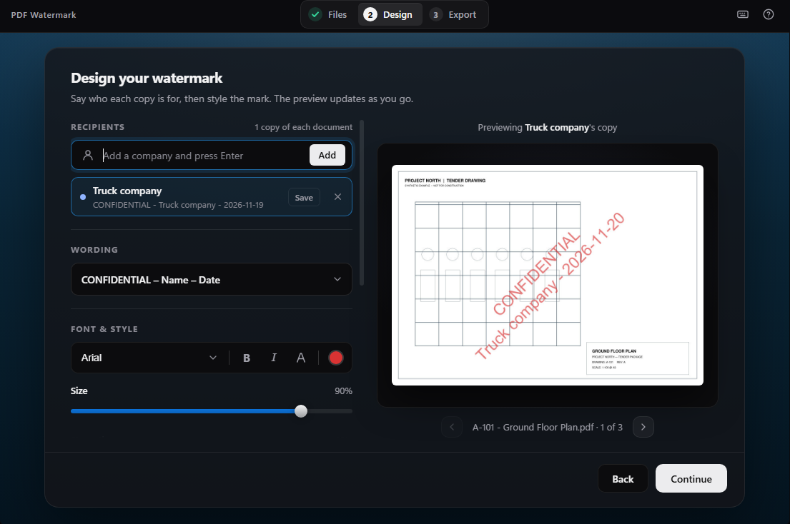

# PDF Watermark

**Batch watermark a whole folder of PDFs in one run.**

Set up your watermark once and apply it to every page, including PDFs in subfolders. The app saves new copies with the same folder structure and keeps your originals intact. Everything runs offline on your Windows PC.

**Windows 10 and 11** · Free

- **Installer** · Open the [latest release](https://github.com/FZ-Labz/pdf-watermark/releases/latest) and choose `PDF-Watermark-Setup.exe` when available. Setup installs for your Windows account and adds a Start menu shortcut.
- **[Portable download](https://github.com/FZ-Labz/pdf-watermark/releases/latest/download/PDF-Watermark-Windows.exe)** · Open the executable directly.



## Watermark a folder

1. **Add files.** Drop a folder into the app or click **Select folder**. You can also add individual PDFs.
2. **Design the watermark.** For a single mark such as `DRAFT`, enter it in **Recipients** and click **Add**. Under **Wording**, choose **Custom**, select **Name only**, and leave **Add today's date** off. Choose a diagonal, tiled, or positioned mark and check the live preview.
3. **Export.** Choose where to save the copies and click **Watermark**.

Sending a pack to several people? Add each name under **Recipients** to export a separately marked set for each person or company.

## 🔏 Code signing policy

GitHub Actions builds the Windows downloads from this repository. Windows SmartScreen may flag the unsigned downloads. Compare your download with the [published SHA-256 checksums](https://github.com/FZ-Labz/pdf-watermark/releases/latest/download/SHA256SUMS.txt).

## 🔒 Privacy and uninstalling

Uninstall the installed app from **Settings → Apps** or **Control Panel → Programs and Features** by selecting **PDF Watermark**. To remove the portable copy, delete its executable.

Documents are processed locally. Uninstalling keeps your PDFs and the app settings in `%APPDATA%\PDF Watermark`. You can delete the settings folder separately to reset the app.

## Help

- If the app flags a PDF as damaged or password-protected, save a readable copy in a PDF editor and add that copy instead.
- If something goes wrong, open an [issue](https://github.com/FZ-Labz/pdf-watermark/issues). You can attach the log at `%APPDATA%\PDF Watermark\app.log`.
- A watermark shows who got a copy. It does not stop anyone opening the file. To restrict access, use encryption.

## For developers

See [CONTRIBUTING.md](CONTRIBUTING.md) for setup, project layout and release steps.

```sh
# Apply one watermark to a whole folder
python batch_watermark.py my_folder --text "DRAFT"

# Export a separate set for each company
python batch_watermark.py my_folder --company "Acme" "Globex"
```

See the [command-line options](CONTRIBUTING.md#command-line-options).

- Licence: MIT, see [LICENSE](LICENSE). The app bundles [PyMuPDF](https://pymupdf.readthedocs.io/) under the [GNU AGPL v3](https://www.gnu.org/licenses/agpl-3.0.html), so the app as distributed is covered by the AGPL. Its source is this repository.
- Thanks to [PyMuPDF](https://pymupdf.readthedocs.io/), [fontTools](https://github.com/fonttools/fonttools) and [pywebview](https://pywebview.flowrl.com/), and to the open-source watermark tools that gave me ideas: [bastienlc/pdf-watermark](https://github.com/bastienlc/pdf-watermark), [ajaxray/markpdf](https://github.com/ajaxray/markpdf), [oclero/pdfwm](https://github.com/oclero/pdfwm), [aanorlondo/pdf-watermark](https://github.com/aanorlondo/pdf-watermark), [TobseF/My-PDF-Watermark](https://github.com/TobseF/My-PDF-Watermark).
